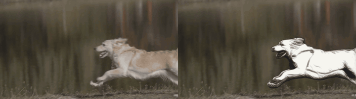
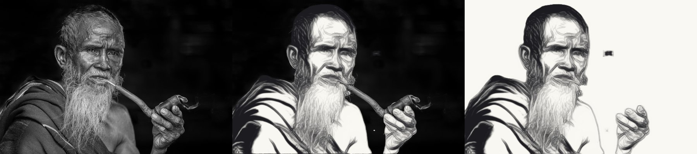
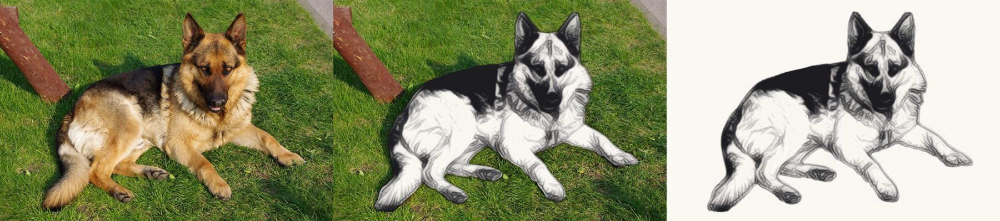
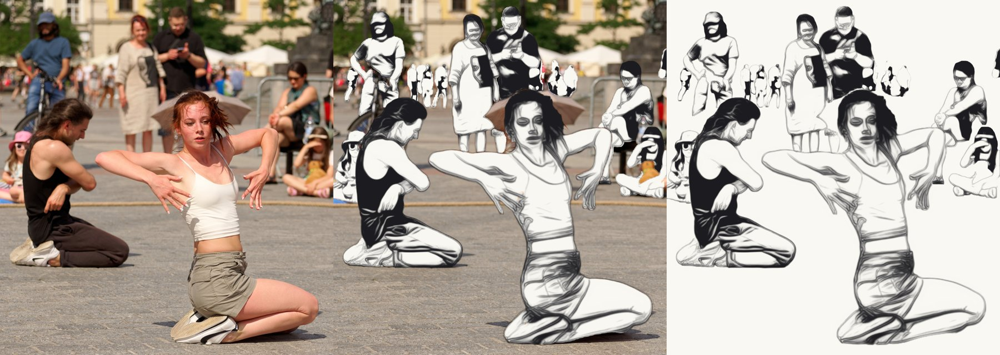
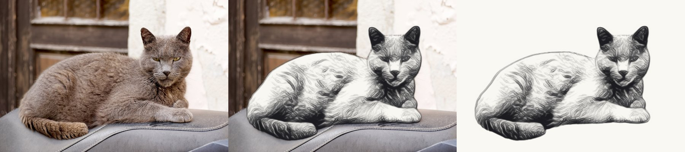

# sam-line

Name an object in a photo or a video, get it back as an ink line drawing — the rest of the frame stays as it was.

SAM 3 finds and tracks the object; a small line-drawing head (2.3M parameters) on top of SAM 3's frozen vision
encoder draws it. The head is one deterministic forward pass per object and frame, so it is fast and gives the
same answer for the same input.

| | |
|---|---|


| | |
|---|---|
|  |  |
|  |  |

More results: [`examples/`](examples/) — each sheet is *photo · drawn in place · drawing only*; the full 10 s video
is [`examples/dog_run_side.mp4`](examples/dog_run_side.mp4).

Weights: [Vision-Decision/sam3-line](https://huggingface.co/Vision-Decision/sam3-line) on the Hugging Face Hub.

## Install

```bash
pip install -r requirements.txt
```

SAM 3 is gated on the Hub: accept its licence at [facebook/sam3](https://huggingface.co/facebook/sam3) and log in
(`hf auth login`). The line head is downloaded from `Vision-Decision/sam3-line` on first use. Needs a CUDA GPU
(about 8 GB for images; video tracking needs more for long clips).

## Use

Images — every instance that matches the prompt is drawn:

```bash
python -m sam_line.image --image photo.jpg --prompt dog --out out/
# out/photo_paper.jpg  drawn in place     out/photo_lines.png  drawing only     out/photo_sheet.jpg  side by side
```

Videos — SAM 3 tracks the prompted objects, every frame is drawn:

```bash
python -m sam_line.video --video clip.mp4 --prompt bird --duration 10 --out out/
# out/paper.mp4  out/lines.mp4  out/side.mp4  out/timing.json
```

Python:

```python
import numpy as np
from PIL import Image
from sam_line import SamLine, compose
from sam_line.image import Segmenter

model = SamLine.from_pretrained()                  # SAM 3 + line head, on CUDA
seg = Segmenter(model.sam, model.config["sam3"])   # text-prompted SAM 3 on the same weights
image = Image.open("photo.jpg").convert("RGB")
masks, scores = seg(image, "cat")
ink = model.draw(np.array(image), masks)           # (H, W) float, 1 = black ink
Image.fromarray(compose(np.array(image), masks, ink, "paper")).save("cat_paper.jpg")
```

`model.draw` takes any boolean masks, so clicks or boxes from another SAM 3 front end work the same way.

## Speed

One NVIDIA H200, bf16.

| stage | time |
|---|---|
| line head alone, per object (batch 16) | 2.2 ms |
| SAM 3 vision encoder + line head, per object (batch 16 / batch 1) | 22 ms / 31 ms |
| image: SAM 3 text segmentation, 2048 px photo (after warm-up) | 75–190 ms |
| image: drawing one object / 18 people | 45 ms / 1.6 s |
| video, 1080p, one dog: SAM 3 tracking / drawing, per frame | 240 ms / 31 ms |
| video, 1080p, one dog: end to end incl. optical flow and writing three videos | 2.0 frames/s (10 s clip in 124 s) |

Most of the time is SAM 3: the tracker, and the encoder pass the head makes on every object crop. The head
itself is a few milliseconds.

## How it works

```
object crop (RGB + mask, long side 512) ─────────────────────────┐
     └─> SAM 3 ViT @1008 ─> stride-7 FPN features ───────────────┤  LineDecoder: U-Net at full crop resolution,
                          └─> mask-pooled stride-14 instance query ┘  FiLM-conditioned ─> grey ink drawing
```

* Training labels come from a one-step line-art teacher (an SD-Turbo model fine-tuned on line drawings made with
  Qwen-Image-Edit), so the head learns one consistent style instead of averaging many.
* The head is trained on pseudo-videos — each photo moved along a random camera path with lighting drift, sensor
  noise and wobbling mask edges — with a flicker loss, so it draws the same strokes when the camera moves.
* In videos, the tracker's mask logits are averaged over a few frames, crop boxes are smoothed in time, and the
  ink is blended with the previous frame's ink moved by optical flow.

## Limitations

* Only what the mask covers is drawn: things the object holds (a pipe, a leash) are left out unless prompted.
* Small, distant objects come out soft; the head works best on objects larger than ~200 px.
* One style (ink). Every frame is drawn on its own, so some stroke shimmer remains in video.

## Credits and licences

* SAM 3 ([facebook/sam3](https://huggingface.co/facebook/sam3)) is used under the SAM License; it is downloaded
  from the Hub, not redistributed here.
* The line head's training labels were produced with [stabilityai/sd-turbo](https://huggingface.co/stabilityai/sd-turbo)
  (Stability AI Community License) and [Qwen/Qwen-Image-Edit-2511](https://huggingface.co/Qwen/Qwen-Image-Edit-2511)
  (Apache-2.0). See the model card for the terms that apply to the weights.
* Example media are from Wikimedia Commons and Pexels; the drawings in `examples/` are derived from them and carry
  the same licence:

| example | source | author | licence |
|---|---|---|---|
| dog_run | [A dog running in the grass with a leash](https://www.pexels.com/video/a-dog-running-in-the-grass-with-a-leash-9190237/) (Pexels) | Yaroslav Bilgovskiy | Pexels License |
| man_pipe | [Bearded man smoking pipe](https://commons.wikimedia.org/wiki/File:Bearded_man_smoking_pipe-3013924.jpg) | ThuyHaBich | CC0 |
| fishmonger | [Fishmonger smiling, Maracaibo street market](https://commons.wikimedia.org/wiki/File:Fishmonger_smiling,_Maracaibo_street_market,_Venezuela.jpg) | Wilfredor | CC0 |
| dancers | [Ulica – Central Europe Dance Theatre](https://commons.wikimedia.org/wiki/File:36._Ulica_-_Central_Europe_Dance_Theatre_-_Audibles_-_20230707_1528_6342.jpg) | Jakub Hałun | CC BY-SA 4.0 |
| german_shepherd | [German Shepherd Dog](https://commons.wikimedia.org/wiki/File:20110425_German_Shepherd_Dog_8505.jpg) | Jakub Hałun | CC BY-SA 4.0 |
| malamute | [Alaskan Malamute](https://commons.wikimedia.org/wiki/File:Alaskan_Malamute_R_Bartz.jpg) | Richard Bartz | CC BY-SA 2.5 |
| cat_piran | [Cat in Piran, Slovenia](https://commons.wikimedia.org/wiki/File:Cat_in_Piran,_Slovenia,_20240504_1600_8594.jpg) | Jakub Hałun | CC BY 4.0 |
| cat_mandalay | [Stray cat, Mandalay Hill](https://commons.wikimedia.org/wiki/File:20160729_-_Stray_cat_-_Mandalay_Hill_-_Mandalay,_Myanmar_-_5862.jpg) | Jakub Hałun | CC BY-SA 4.0 |
